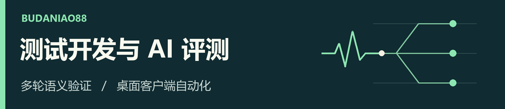
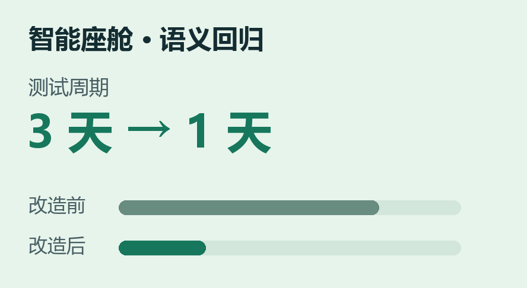
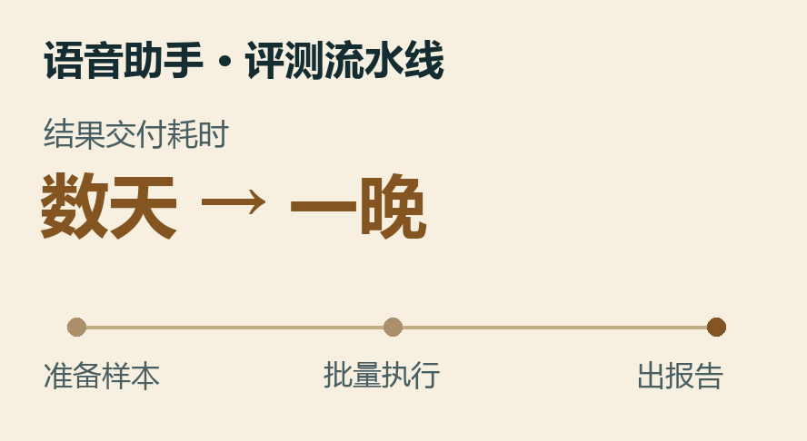
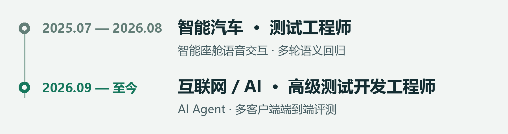

我从智能座舱语音测试做起，验证用户确认、取消或追加指令后，系统有没有执行正确的动作。现在做 AI Agent 评测平台，把多个桌面客户端的任务调度、异常恢复和结果回收串成一条可追溯的执行链路。[查看代表项目 →](https://github.com/budaniao88/e2e-eval-platform#readme)

## 工程成果

  
  

- **缩短回归周期。** 用 Python 构造场景数据，逐轮校验动作和参数；通过 Jenkins 触发执行、Allure 汇总结果，把原先需要人工串联的步骤合并到一次回归中。
- **加快报告交付。** 将语音样本准备与批量评测拆开，中断任务从检查点补跑。报告直接从已保存的结构化结果生成，复核时可以重新生成报告而无需再跑整批任务。

## 职业经历

在智能汽车行业，我负责语音场景的测试设计、工具研发与版本准出。转向 AI 应用后，工作对象从一次多轮对话扩展到一项完整任务：既要确认客户端受理了请求，也要核对返回的答复和文件属于哪次执行。

## 代表项目 · 多客户端 AI Agent 端到端评测平台

**如果客户端已经接单，采集进程却重启了，怎样把原结果找回来？**

平台在发送前保存意图，将受理回执绑定到原会话。采集中断后，Worker 核对原执行记录，从对应会话补采；受理状态未知时，先隔离资源并核对现场。公开设计文档给出了调度中心、Worker 和客户端之间的执行时序，以及不同故障状态下的恢复动作。[阅读架构与恢复设计 →](https://github.com/budaniao88/e2e-eval-platform#readme)
